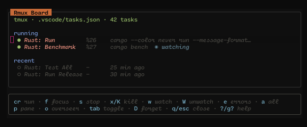

# rmux.nvim



> **⚠️ EARLY DEVELOPMENT**
> This plugin is still under active development. Most features work, but the API, config, and keymaps may change without notice. Use at your own risk and report any issues you find.

A task runner for Neovim that wraps `tasks.json` (VSCode-style) using [overseer.nvim](https://github.com/stevearc/overseer.nvim) as the execution backend, with support for multiple multiplexers (tmux, herdr).

---

## Features

- **`tasks.json` wrapper** — use VSCode-style task configs, executed through `overseer.nvim`.
- **Multi-multiplexer** — auto-detect or pick manually: `tmux`, `herdr`.
- **Board UI** — interactive panel to view, run, stop, and watch tasks.
- **Notifications** — optional notification when a task finishes or fails.
- **Quickfix & location list** — jump straight to errors from task output.
- **Watch / unwatch** — keep an eye on specific tasks without opening the board.
- **Configurable keymaps** — every keymap can be changed, or disabled with `false`.

---

## Installation

### lazy.nvim

```lua
{
  "MadKuntilanak/rmux",
  event = "VeryLazy",
  opts = {},
}
```

With custom config:

```lua
{
  "MadKuntilanak/rmux",
  event = "VeryLazy",
  opts = {
    rmuxdirrc = vim.fn.stdpath("cache") .. "/runmux",
    run_with = "auto", -- "tmux" | "herdr" | "auto"
    setnotif = true,
    debug = false,
    quickfix = {
      copen = "belowright copen",
      lopen = "belowright lopen",
    },
    board = {
      keymaps = {
        -- Use `false` to disable a keymap.
        focus = "f",
        run = "<CR>",
        stop = "s",
        kill = { "x", "K" },
        forget = "D",
        watch = "w",
        unwatch = "W",
        error = "e",
        all = "a",
        select_pane = "p",
        overseer = "o",
        toggle_group = "<Tab>",
        close = { "q", "<Esc>" },
        help = { "?", "g?" },
      },
    },
  },
}
```

> **Requirements:** `overseer.nvim` (required), plus one of `tmux` / `herdr` depending on `run_with`.

---

## Configuration

| Option | Type | Default | Description |
|--------|------|---------|-------------|
| `rmuxdirrc` | `string` | `stdpath("cache") .. "/runmux"` | Runtime/cache directory for rmux. |
| `run_with` | `string` | `"auto"` | Multiplexer to use: `"tmux"`, `"herdr"`, or `"auto"` (auto-detect). |
| `setnotif` | `boolean` | `true` | Show a notification when a task finishes or fails. |
| `debug` | `boolean` | `false` | Enable debug logging. |
| `quickfix.copen` | `string` | `"belowright copen"` | Command used to open quickfix. |
| `quickfix.lopen` | `string` | `"belowright lopen"` | Command used to open the location list. |
| `board.keymaps.*` | `string \| string[] \| false` | see example | Board keymaps. Set `false` to disable. |

### Board keymaps

| Action | Default | What it does |
|--------|---------|--------------|
| `focus` | `f` | Focus the task pane. |
| `run` | `<CR>` | Run the task. |
| `stop` | `x` | Stop the task (soft). |
| `kill` | `K` | Kill the task (force). |
| `forget` | `D` | Remove the task from the board. |
| `watch` | `w` | Mark task to watch. |
| `unwatch` | `W` | Stop watching a task. |
| `error` | `e` | Open errors (quickfix/location list). |
| `all` | `a` | Show all tasks. |
| `select_pane` | `s` | Select a multiplexer pane. |
| `overseer` | `o` | Open the `overseer.nvim` UI. |
| `toggle_group` | `<Tab>` | Expand/collapse a task group. |
| `close` | `q`, `<Esc>` | Close the board. |
| `help` | `?`, `g?` | Show help. |

---

## Usage

1. Put a `tasks.json` in your project root (VSCode-compatible format).
2. Open the rmux board (see commands below).
3. Select a task → `<CR>` to run, `x` to stop, `e` to jump to errors.

> Commands and API details will land in `:help rmux` — still a work in progress.

---

## Related / Prior Art

There are already plenty of great task and code runners in the Neovim
ecosystem. If `rmux` isn't what you're looking for, browse the
[awesome-neovim code runner list](https://github.com/rockerBOO/awesome-neovim#code-runner) or
check out plugins like `overseer.nvim`, `toggleterm.nvim`, `sniprun`,
`neotest`, and `project.nvim`.

---

## Status

- [x] `tasks.json` wrapper
- [x] `overseer.nvim` integration
- [x] `tmux` / `herdr` support
- [x] Board UI + custom keymaps
- [x] Quickfix & location list
- [x] Notifications
- [ ] Full `:help` docs
- [ ] Test suite
- [ ] API stabilization

---

## License

MIT — free to use, modify, and distribute. See `LICENSE` for details.

---

## Contributing

Since this is early-stage, issues, PRs, and ideas are all welcome. If you hit a bug, include:
- Neovim version (`:version`)
- which multiplexer you're using
- your `rmux` config
- reproduction steps

---

**Try it out — and remember, this is still experimental.** 🚧
